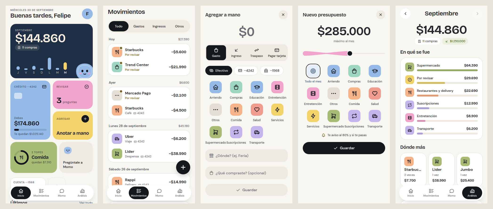
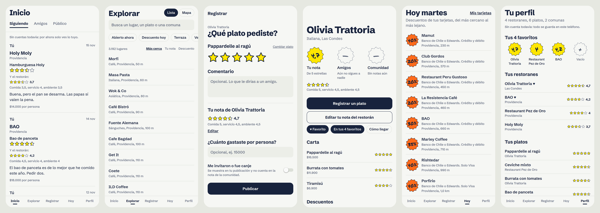
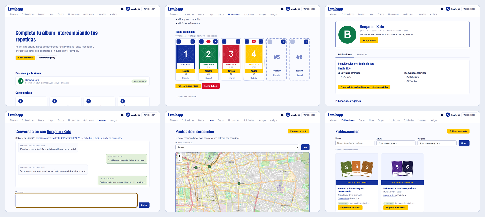

# Hola, soy Felipe

Estudio Ingeniería Civil Industrial con Diploma en Computación en la Pontificia Universidad Católica de Chile, en Santiago. Me interesa la inteligencia artificial aplicada a productos de uso diario.

Fundador y desarrollador de **Duplicia**, un estudio que construye apps con IA integrada. Hoy trabajo en su primera app, **Momo**, y en **Fudi**, una app social de restoranes. En la universidad desarrollé **Laminapp** con mi equipo de Ingeniería de Software.

## Momo: tus gastos, sin anotarlos

App de finanzas personales para quien nunca llevó control de sus gastos. En vez de pedirte que anotes cada compra, lee los avisos que te manda el banco: los reenvías a tu dirección de Momo y cada compra aparece sola, con su comercio y su categoría.

**Qué hace**

- Registra compras, transferencias y pagos desde los correos del banco, y lee cartolas en PDF.
- Aprende a categorizar: confirmas un comercio una vez y las compras siguientes ahí se resuelven solas, sin volver a llamar al modelo.
- Un asistente conversacional responde con tus datos reales ("¿cuánto gasté en comida este mes?"). Cuando hay que cambiar algo, lo propone y tú lo confirmas.
- Cuentas y tarjetas con saldo, compras en cuotas, presupuestos con avisos, resumen semanal y gastos compartidos con amigos.
- Inicio en bento editable: cada baldosa muestra una sola idea y las ordenas a tu gusto.

**Stack**

| | |
|---|---|
| App | React Native con Expo (Expo Router, Reanimated, Gesture Handler) y TypeScript |
| Backend | Supabase: Postgres con RLS, funciones en PL/pgSQL, Edge Functions (Deno) y pg_cron |
| Correo | Cloudflare Email Routing y Email Workers |
| IA | DeepSeek V4 Flash para extraer datos de los correos y para el asistente (tool calling) |
| Web | Cloudflare Pages y Turnstile |

**Algunas decisiones**

- **Reenvío de correo en vez de OAuth a Gmail.** Leer el correo con `gmail.readonly` es un permiso restringido que, pasado cierto número de usuarios, exige una auditoría de seguridad anual. Con un filtro de reenvío el usuario elige qué comparte, funciona con cualquier proveedor de correo y no hace falta esa auditoría.
- **Un modelo barato extrae y las reglas evitan repetir.** El LLM saca monto, comercio y fecha del correo. Cuando el usuario confirma un comercio queda una regla, y las compras siguientes ahí ya no pasan por el modelo.
- **El asistente no escribe en la base.** Consulta con funciones de Postgres limitadas a los datos del usuario, y para crear o cambiar algo devuelve una propuesta que la app muestra para confirmar. Un error del modelo nunca termina en datos inventados.
- **Expo para publicar sin Mac.** Desarrollo en Linux y pruebo en un iPhone: Expo compila iOS en la nube y deja actualizar la app sin pasar otra vez por la revisión de la tienda.
- **Un lenguaje de diseño propio.** Bento, grises neutros con pasteles planos y movimiento con resortes, a partir de componentes web de [000h](https://000h.cojeev.com/) (MIT) portados a nativo con Reanimated.

Momo está en desarrollo y ya registra gastos reales a diario. El código es privado: si quieres verlo para una entrevista, escríbeme por [LinkedIn](https://www.linkedin.com/in/felipegpassi) y lo revisamos juntos.

## Contacto

[LinkedIn](https://www.linkedin.com/in/felipegpassi)

## Fudi: dónde comer hoy, qué pedir y con qué descuento

Diario social de restoranes y platos para Santiago, como Letterboxd pero de comida. Calificas lo que comes, ves qué piden tus amigos y la app te muestra los descuentos de tus tarjetas que aplican hoy cerca de ti.

**Qué hace**

- Calificas el restorán (comida, servicio y ambiente) y cada plato por separado, con estrellas de 0,5 a 5.
- Inicio social con tres modos: la gente que sigues, solo amigos o todo el público.
- Más de 3.000 lugares reales de Santiago, con mapa, filtros (abierto ahora, descuento hoy, terraza, vegano) y búsqueda de platos.
- La pestaña Hoy junta los descuentos bancarios del día según tus tarjetas, del más cercano al más lejano.
- Funciona sin cuenta desde el primer día: tu diario, tus antojos y tus favoritos quedan en el teléfono y se suben solos cuando te registras.

**Stack**

| | |
|---|---|
| App | React Native con Expo (Expo Router, Reanimated, react-native-maps) y TypeScript |
| Backend | Supabase: Postgres con PostGIS y seguridad por fila |
| Datos | OpenStreetMap para los lugares y extractores propios en Node para los descuentos bancarios |

**Algunas decisiones**

- **Un plato tiene su propia nota.** Las estrellas de Google no dicen qué pedir. Separar comida, servicio y ambiente, y calificar cada plato, da información que sirve. La nota de la comunidad usa un promedio bayesiano y no cuenta las visitas por canje.
- **Descuentos desde el banco, no de terceros.** Revisé 17 bancos. Donde el banco publica sus datos abiertamente, un extractor los lee: en Banco de Chile, 920 beneficios se convierten en 434 promociones de comida. Donde hay protección anti-bot no se salta: la carga es manual una vez al mes, con extracción por IA.
- **Datos abiertos en vez de Google Places.** Google prohíbe guardar sus datos, así que la base de lugares sale de OpenStreetMap.
- **Útil sin red social.** Una red social nueva está vacía el primer día, así que la app sirve sola como diario y buscador de descuentos, y lo social suma encima.

Fudi es un prototipo que ya corre en iPhone con datos reales; ahora estoy conectando las cuentas y la parte social. El código es privado.

## Laminapp: completa tu álbum cambiando repetidas

Plataforma web para coleccionistas de láminas: marcas cuáles tienes, cuáles te faltan y cuáles repetiste, y la app te dice con quién te conviene cambiar. Proyecto semestral de Ingeniería de Software en la UC (2026-2), hecho por un equipo de 3 en sprints, con relatos de usuario y Gitflow.

**Qué hace**

- Cruza tus repetidas con las faltantes de otras personas, álbum por álbum, y arma la propuesta de intercambio con las láminas ya marcadas.
- Acompaña todo el intercambio: solicitud, chat privado, punto de encuentro en un mapa y confirmación de ambas partes, que actualiza las colecciones solas.
- Reseñas entre coleccionistas, amigos, grupos con ofertas privadas y notificaciones en la app y por correo.
- Panel de administración con suspensiones, moderación de reseñas y lectura de chats auditada.

**Stack**

| | |
|---|---|
| Backend | Ruby on Rails 8.1 con PostgreSQL |
| Mapa | Leaflet y OpenStreetMap |
| Servicios | Brevo para correo y Cloudinary para imágenes |
| Calidad y despliegue | Minitest con 98 % de cobertura, Rubocop y Render |

**Mi parte**

Fui el integrante con más aportes (48 % de los commits): registro e inicio de sesión, el motor de coincidencias, el chat con aviso de no leídos, las reseñas, el mapa de puntos de intercambio, la recuperación de contraseña, las notificaciones y el buscador con filtros. También integré las entregas de cada sprint.

**Algunas decisiones**

- **Una cantidad por lámina.** Todo el modelo gira en torno a cuántas tiene cada persona de cada lámina, y con eso se calculan las coincidencias en cada visita, sin datos duplicados que se desactualicen.
- **Correo por API.** El plan gratuito de Render bloquea SMTP, así que el correo sale por la API de Brevo.
- **Moderación con registro.** La administración puede leer los chats para resolver reclamos, pero solo en lectura, y cada lectura queda registrada.

[Ver la aplicación](https://laminas-wklf.onrender.com) (la primera carga tarda cerca de un minuto porque el servidor gratuito se suspende). El código pertenece al curso y es privado.
